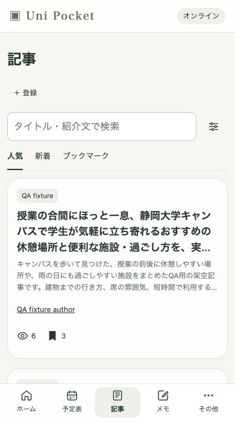
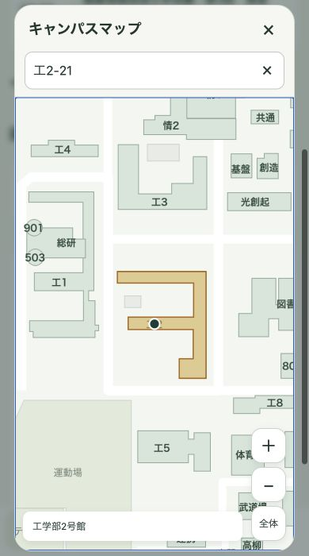
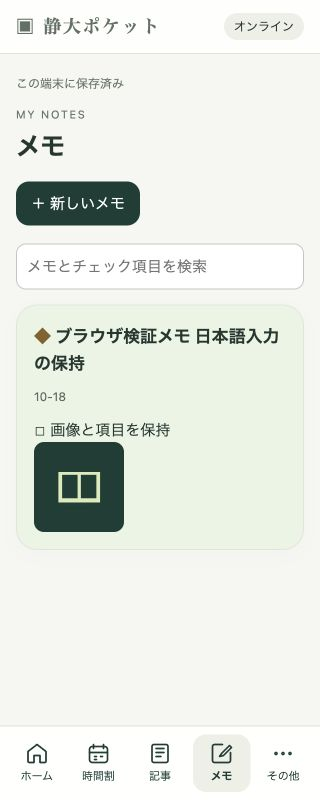
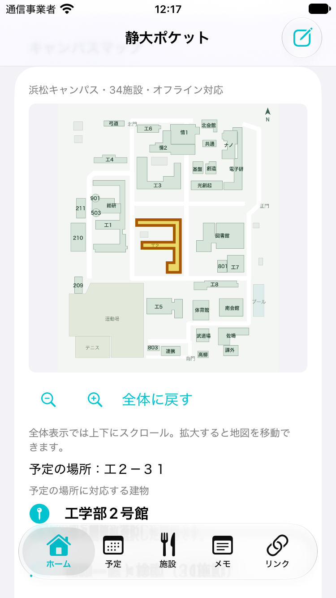
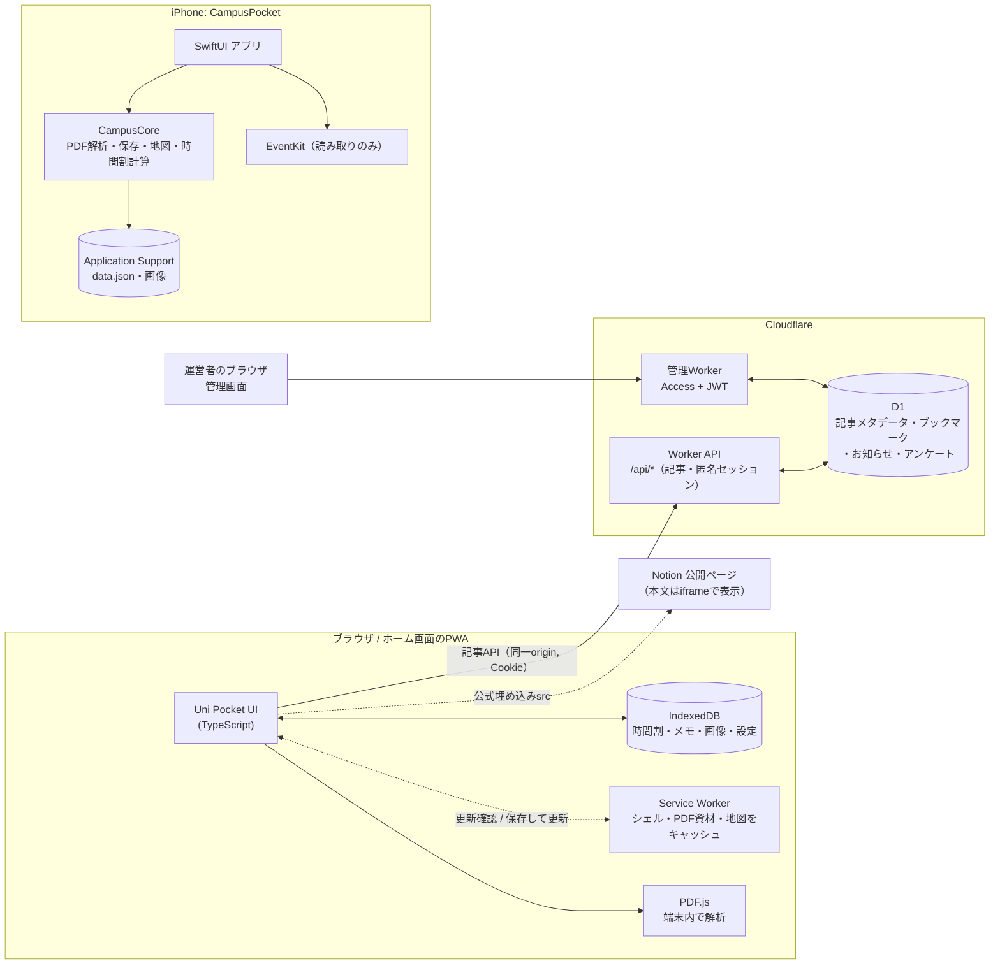

# Uni Pocket / CampusPocket

静岡大学 浜松キャンパスの学生向けに作った、時間割・予定・キャンパスマップ・メモ・学内記事を1つにまとめたアプリです。大学のPDF（履修登録確認票・年間行事予定表）を端末内で解析して授業予定を作り、教室名から建物を地図で示します。個人のデータは端末から出さず、学生どうしで共有したい記事（Notionの公開ページ）だけを小さな共有APIに登録します。

最初にiPhone版 **CampusPocket**（SwiftUI）を作り、その後、URLを配るだけで誰でも使えるように **Uni Pocket**（PWA + Cloudflare Workers）へ展開しました。現在の開発の中心はPWAです。

| PWA: 記事 | PWA: キャンパスマップ | PWA: メモ | iOS: ホーム内の地図 |
|---|---|---|---|
|  |  |  |  |

スクリーンショットは開発中の検証記録から引用しています（記事・メモの内容は検証用データです）。

## 主な機能

**Uni Pocket（PWA, `web/`）**

- **時間割と予定表**: 履修登録確認票・年間行事予定表のPDFをブラウザ内で解析し、授業回・休講・振替を反映。再取込時は差分を表示し、個人の修正と衝突する回は利用者の選択を必須にする
- **キャンパスマップ**: 34施設・42教室の対応表を同梱し、オフラインで教室名から建物を強調表示
- **メモ**: チェック項目・画像付きメモを自動保存。ホームへの固定
- **記事**: Notionの公開ページを共有記事として登録・閲覧・ブックマーク。ログイン不要の匿名セッションで投稿の編集権限を管理
- **管理画面**: 記事の非表示・通報確認、お知らせ・アンケート、閲覧数・回答の集計、運営記事の投稿（別Worker・所有者限定）
- **テーマ**: 配色・ライト/ダーク・背景画像。アプリ更新は利用者の操作で適用

**CampusPocket（iOS, `CampusPocket/` + `CampusCore/`）**

- PDFKitによる同じPDF取込と差分確認、週間・日・月表示、授業の個人修正
- ホームに埋め込んだキャンパスマップ、施設の営業時間、メモ（原寸画像）、リンク
- EventKitによるOutlook予定の読み取り表示（書き込みなし）
- 掲示板・記事の操作見本（WebView、端末内のみ）と記事下書きの原子的保存

## 技術スタック

| 領域 | 使用技術 |
|---|---|
| PWAクライアント | TypeScript, Vite, PDF.js（`pdfjs-dist`、CMap・フォント・WASMを同梱）, IndexedDB, Service Worker, Web Locks |
| 共有API | Cloudflare Workers（TypeScript）, Cloudflare D1（SQLite）, Static Assets, Cron Trigger |
| 管理画面 | TypeScript, Vite, 別Worker + Cloudflare Access（JWT検証） |
| テスト・静的検査 | Vitest, Node test runner, Miniflare（実workerd/D1）, Wrangler結合テスト, ESLint（typescript-eslint）, Prettier, GitHub Actions |
| iOSアプリ | Swift, SwiftUI, PDFKit, EventKit, WebKit, iOS 17+ |
| iOS共通ロジック | ローカルSwift Package `CampusCore`（XCTest） |

## アーキテクチャ



- 時間割・PDF由来の予定・メモ・画像・設定はすべて端末内（PWAはIndexedDB、iOSはApplication Support）に保存します。サーバーに届くのは共有記事の公開URL・一覧情報と、匿名セッションに紐づく投稿・ブックマーク・閲覧・アンケート回答だけです。
- サーバーはNotionを取得しません。Notion公式の埋め込みコードから `src` だけを検証して保存し、本文はブラウザがNotionから直接表示します。
- iOS版とPWAはデータを共有しない独立したアプリです（旧Swiftデータの自動移行は対象外）。

## クイックスタート

### PWA

Node.js 22.23.4+ / 24.22.1+ / 26.12.1+ の各系列が必要です（[理由と詳細](docs/toolchain.md)）。

```sh
cd web
npm ci
npm run verify:tls      # CA bundleとTLS検証（7日間有効）
npm run build           # PWAをweb/distへビルド（localが配信する静的資材）
npm run db:local        # ローカルD1へmigrationを適用
npm run local           # http://127.0.0.1:8787 でPWAとAPIを起動（Cloudflare認証不要）
```

UIだけを編集するときは `npm run dev`（Vite、APIは8787へプロキシ）。管理画面は `npm run dev:admin` です（[手順](web/admin/README.md)）。

### iOS

1. `CampusPocket.xcodeproj` をXcodeで開き、scheme `CampusPocket` を選択
2. Simulatorで実行（実機はXcodeのSigning設定と開発者モードが必要）

## テスト

新しいcheckoutでは、先に `npm run verify:tls`（ネットワークが必要）を済ませてください。検証記録がないと、実workerdを使う `test:runtime`（`test:all` に含まれる）は起動を止めます。

```sh
cd web
npm run format:check && npm run lint   # Prettier / ESLint
npm run typecheck && npm run typecheck:admin
npm run test:all          # toolchain / クライアント / 管理画面 / SQLite API / 実workerd+D1
npm run test:integration  # ビルド後、実Wrangler + 一時D1で結合テスト
```

```sh
DEVELOPER_DIR=/Applications/Xcode.app/Contents/Developer ./scripts/test-core.sh   # CampusCore
node scripts/test-board.cjs && node scripts/test-articles.cjs                     # iOS内のWebView部分
```

GitHub Actions（`.github/workflows/ci.yml`）が push / PR ごとに、`web/` の `verify:tls`・整形・lint・型検査・`test:all`・`test:integration`（Ubuntu）と CampusCore の `swift test`（macOS）を実行します。依存の `npm audit` は週1回（`audit.yml`）です。`npm run format` で整形します。整形だけのコミットを blame から除くには、`git config blame.ignoreRevsFile .git-blame-ignore-revs` を一度実行してください。

テストの内容と日付付きの検証記録は [docs/testing.md](docs/testing.md) にあります。

## ディレクトリ構成

```text
.
├── web/                  PWA「Uni Pocket」
│   ├── src/              クライアント（画面・保存・PDF解析・地図・更新）
│   ├── server/           Cloudflare Worker（共有API・管理API）
│   ├── admin/            管理画面クライアント
│   ├── migrations/       D1スキーマのmigration
│   ├── scripts/          ビルド、Service Worker生成、実行系・TLSガード
│   ├── tests/            単体・実D1・結合テスト
│   └── public/           マニフェスト、アイコン、地図画像
├── CampusPocket/         iOSアプリ（SwiftUI画面、同梱HTMLリソース）
├── CampusCore/           iOSの共通ロジック（Swift Package + テスト）
├── CampusPocket.xcodeproj
├── scripts/              iOS向けテスト・地図データ再生成スクリプト
└── docs/                 詳細文書と開発記録（docs/harness）
```

## 設計上の判断

- **オフラインファースト・端末内保存**: 個人データは端末内にだけ置き、記事APIが落ちても時間割・メモ・地図は動きます。PDF.jsの資材と地図をService Workerで同梱し、オフラインでも解析・表示できます。
- **複数タブでも上書きしない保存**: IndexedDBへの保存はトランザクションとrevision照合で行い、別タブの保存を検出したら書き込みを拒否して入力を画面に残します。読み込めないデータを初期値で上書きしません。iOS版も原子的書き込みと、移行前の原本退避（schema=1→2）を行います。
- **利用者が確定する更新**: 新しいService Workerは全資材を取得できた場合だけ待機状態にし、利用者の「保存して更新」→全タブへ保存要求→全タブ成功→`skipWaiting`→1回の再読み込み、の順で適用します。IME入力・画像処理・PDF解析中や保存失敗時は更新しません。
- **PDF由来の予定と個人修正を分けて保存**: 再取込は差分として表示し、個人修正がある回は「修正を保持」か「新PDFを採用」を選ぶまで保存しません。既知の書式だけを検証付きで取り込み、未知の書式やOCRを推測で取り込みません。
- **プライバシーの境界**: PDF原本・氏名・学籍番号は保存しません。時間割・メモ・画像は端末内にだけ保存し、サーバーへは送信しません（サーバーに届く情報は「アーキテクチャ」の節に記載）。匿名セッションは `HttpOnly; Secure; SameSite=Strict` のCookieで、D1には秘密値のSHA-256ハッシュだけを保存します。
- **管理機能の分離**: 管理画面は別originの別Workerとし、Cloudflare Accessに加えてサーバー側でJWTの署名・issuer・audience・期限・所有者を検証します。変更操作は冪等キーとrevisionで二重送信・競合を防ぎます。
- **ツールチェーンのTLS防御**: 危殆化した証明書を受け入れる開発ツール経路を見つけたため、修正版Nodeだけを許可し、CA bundleでの検証に失敗したらローカルWorker・テスト・Wranglerを起動しないガードを入れました（[詳細](docs/toolchain.md)）。

詳細は [web/CLIENT.md](web/CLIENT.md)、[web/DEPLOY.md](web/DEPLOY.md)、[docs/ios.md](docs/ios.md) にあります。

## 現在の状況と制約

- PWAはCloudflareの `env.preview` 環境（Worker `uni-pocket-preview` + D1）で一般公開しています（2026-10-20公開、2026-10-23に最新版を配信。経緯は [docs/pwa.md](docs/pwa.md#配信状況と未確認事項)）。`env.production` は予約設定のみで未接続です。
- Android/iPhone実機でのインストール・更新の網羅確認、旧iPhone実機での更新適用、クラウド上のD1バックアップ復元は未確認です。
- PDF取込は既知の後期の履修登録確認票と通常課程の年間行事予定表だけが対象です（前期・未知形式・画像のみのPDFは非対応）。
- iOS版は署名なしビルドとSimulatorで確認しています。実機での大学Outlook接続・VoiceOver操作などは未確認です。
- 施設の営業時間は確認日付きの目安です。

## ドキュメント

- [docs/README.md](docs/README.md): 詳細文書の索引（PWA、iOS、テスト、ツールチェーン）
- [docs/harness/README.md](docs/harness/README.md): 開発記録。仕様 → 承認 → 実装 → 独立レビュー → 検証、の流れでAIと進めたタスク001〜024の記録
