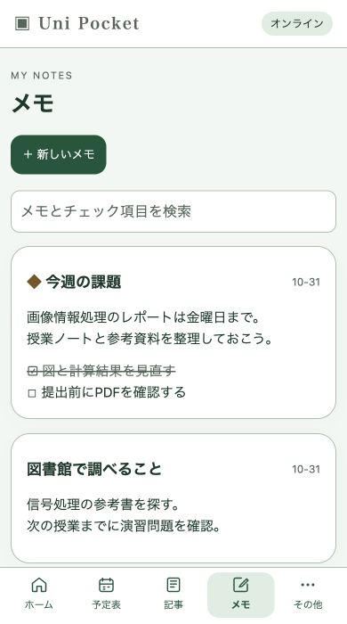
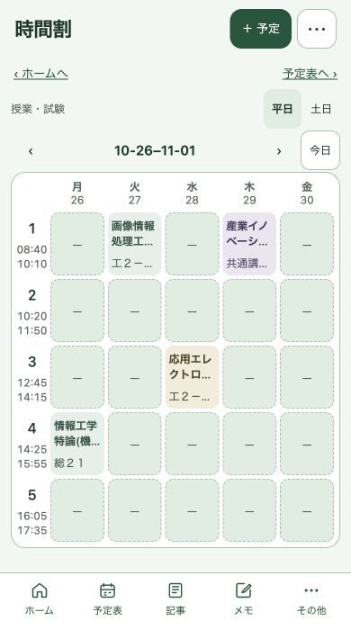
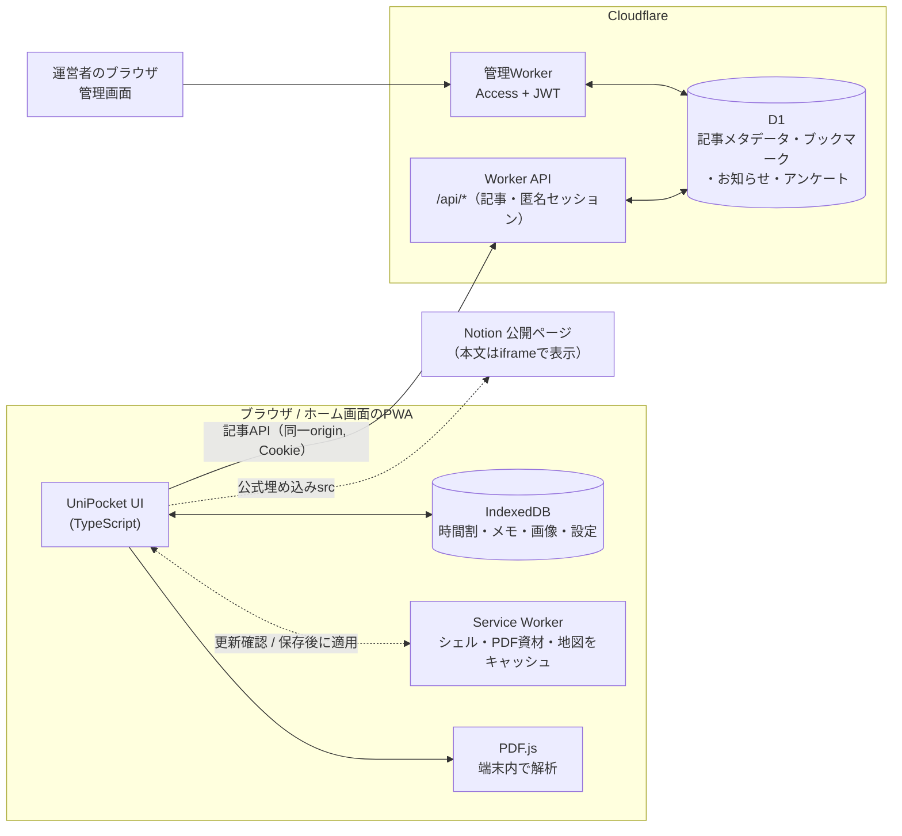

# UniPocket

静岡大学 浜松キャンパスの学生向けに、時間割・予定表・キャンパスマップ・メモ・学内記事をまとめたPWAです。大学のPDF（履修登録確認票・年間行事予定表）をブラウザ内で解析し、授業予定の作成から教室の場所の確認までをつなぎます。

**[UniPocketを開く](https://uni-pocket-preview.kan0507kt.workers.dev/)** — アカウント登録なしで利用でき、スマートフォンのホーム画面にも追加できます。時間割・メモ・画像は端末内に保存し、Notion記事の一覧情報やブックマークなどの共有機能はCloudflare Workers + D1で提供します。

| PWA: 記事 | PWA: キャンパスマップ | PWA: メモ | PWA: 時間割 |
|---|---|---|---|
|  |  |  |  |

スクリーンショットはPWAの実画面です。記事・メモの内容は検証用データ、時間割は履修登録PDFの取込例です。画像のサイズはすべて390×700です。

## 主な機能

- **時間割と予定表**: 履修登録確認票・年間行事予定表のPDFをブラウザ内で解析し、授業回・休講・振替を反映。再取込時は差分を表示し、個人の修正と衝突する回は利用者の選択を必須にする
- **キャンパスマップ**: 34施設・42教室の対応表を同梱し、オフラインで教室名から建物を強調表示
- **メモ**: チェック項目・画像付きメモを自動保存。ホームへの固定
- **記事**: Notionの公開ページを共有記事として登録・閲覧・ブックマーク。ログイン不要の匿名セッションで投稿の編集権限を管理
- **管理画面**: 記事の非表示・通報確認、お知らせ・アンケート、閲覧数・回答の集計、運営記事の投稿（別Worker・所有者限定）
- **テーマと更新**: 配色・ライト/ダーク・背景画像を選択。起動時に更新を確認し、編集中やPDF取込中は完了を待って自動適用

## 技術スタック

| 領域 | 使用技術 |
|---|---|
| PWAクライアント | TypeScript, Vite, PDF.js（`pdfjs-dist`、CMap・フォント・WASMを同梱）, IndexedDB, Service Worker, Web Locks |
| 共有API | Cloudflare Workers（TypeScript）, Cloudflare D1（SQLite）, Static Assets, Cron Trigger |
| 管理画面 | TypeScript, Vite, 別Worker + Cloudflare Access（JWT検証） |
| テスト・静的検査 | Vitest, Node test runner, Miniflare（実workerd/D1）, Wrangler結合テスト, ESLint（typescript-eslint）, Prettier, GitHub Actions |

## アーキテクチャ



- 時間割・PDF由来の予定・メモ・画像・設定は端末内のIndexedDBに保存します。サーバーに届くのは共有記事の公開URL・一覧情報と、匿名セッションに紐づく投稿・ブックマーク・閲覧・アンケート回答です。
- サーバーはNotionを取得しません。Notion公式の埋め込みコードから `src` だけを検証して保存し、本文はブラウザがNotionから直接表示します。

## ローカルで動かす

Node.js 22.23.4+ / 24.22.1+ / 26.12.1+ の各系列が必要です（[理由と詳細](docs/toolchain.md)）。リポジトリを取得した後、`web/`で実行します。

```sh
cd web
npm ci
npm run verify:tls      # CA bundleとTLS検証（7日間有効）
npm run build           # PWAをweb/distへビルド（localが配信する静的資材）
npm run db:local        # ローカルD1へmigrationを適用
npm run local           # http://127.0.0.1:8787 でPWAとAPIを起動（Cloudflare認証不要）
```

UIだけを編集するときは `npm run dev`（Vite、APIは8787へプロキシ）。管理画面は `npm run dev:admin` です（[手順](web/admin/README.md)）。

## テスト

新しいcheckoutでは、先に `npm run verify:tls`（ネットワークが必要）を済ませてください。検証記録がないと、実workerdを使う `test:runtime`（`test:all` に含まれる）は起動を止めます。

```sh
cd web
npm run format:check && npm run lint   # Prettier / ESLint
npm run typecheck && npm run typecheck:admin
npm run test:all          # toolchain / クライアント / 管理画面 / SQLite API / 実workerd+D1
npm run test:integration  # ビルド後、実Wrangler + 一時D1で結合テスト
```

GitHub Actions（`.github/workflows/ci.yml`）はmainへのpushとPRで、`web/`の整形・lint・TLS検証・型検査・単体テスト・結合テストを実行します。依存の`npm audit`は週1回（`audit.yml`）です。`npm run format`で整形します。整形だけのコミットをblameから除くには、`git config blame.ignoreRevsFile .git-blame-ignore-revs`を設定してください。

詳しいテスト内容、Swift版を含むCIの構成、日付付きの検証記録は[docs/testing.md](docs/testing.md)にあります。

## ディレクトリ構成

```text
.
├── web/                  UniPocketのアプリとAPI
│   ├── src/              クライアント（画面・保存・PDF解析・地図・更新）
│   ├── server/           Cloudflare Worker（共有API・管理API）
│   ├── admin/            管理画面クライアント
│   ├── migrations/       D1スキーマのmigration
│   ├── scripts/          ビルド、Service Worker生成、実行系・TLSガード
│   ├── tests/            単体・実D1・結合テスト
│   └── public/           マニフェスト、アイコン、地図画像
├── .github/workflows/    CI・依存の定期監査
└── docs/                 詳細文書と開発記録（docs/harness）
```

## 設計上の判断

- **オフラインファースト・端末内保存**: 個人データは端末内にだけ置き、記事APIが落ちても時間割・メモ・地図は動きます。PDF.jsの資材と地図をService Workerで同梱し、オフラインでも解析・表示できます。
- **複数タブでも上書きしない保存**: IndexedDBへの保存はトランザクションとrevision照合で行い、別タブの保存を検出したら書き込みを拒否して入力を画面に残します。読み込めないデータを初期値で上書きしません。
- **保存を待って適用する更新**: 起動時や画面へ戻ったときに更新を確認します。新しいService Workerが全資材を取得し、全タブの入力保存が成功してから自動で切り替えます。IME入力・画像処理・PDF取込中は終了を待ち、保存失敗時は現在の版と入力を保持します。「その他」からの手動確認・適用にも対応します。
- **PDF由来の予定と個人修正を分けて保存**: 再取込は差分として表示し、個人修正がある回は「修正を保持」か「新PDFを採用」を選ぶまで保存しません。既知の書式だけを検証付きで取り込み、未知の書式やOCRを推測で取り込みません。
- **プライバシーの境界**: PDF原本・氏名・学籍番号は保存しません。時間割・メモ・画像は端末内にだけ保存し、サーバーへは送信しません（サーバーに届く情報は「アーキテクチャ」の節に記載）。匿名セッションは `HttpOnly; Secure; SameSite=Strict` のCookieで、D1には秘密値のSHA-256ハッシュだけを保存します。
- **管理機能の分離**: 管理画面は別originの別Workerとし、Cloudflare Accessに加えてサーバー側でJWTの署名・issuer・audience・期限・所有者を検証します。変更操作は冪等キーとrevisionで二重送信・競合を防ぎます。
- **ツールチェーンのTLS防御**: 危殆化した証明書を受け入れる開発ツール経路を見つけたため、修正版Nodeだけを許可し、CA bundleでの検証に失敗したらローカルWorker・テスト・Wranglerを起動しないガードを入れました（[詳細](docs/toolchain.md)）。

クライアントの詳細は[web/CLIENT.md](web/CLIENT.md)、配信と復旧の手順は[web/DEPLOY.md](web/DEPLOY.md)にあります。

## 現在の状況と制約

- Cloudflareの`env.preview`環境（Worker `uni-pocket-preview` + D1）で一般公開しています。2026-10-31にマージ済みmainを配信しました（[配信・検証記録](docs/harness/tasks/026-merged-main-release.md)）。`env.production`は予約設定のみで未接続です。
- Android/iPhone実機でのインストール・更新の網羅確認、旧iPhone実機での更新適用、クラウド上のD1バックアップ復元は未確認です。
- PDF取込は既知の後期の履修登録確認票と通常課程の年間行事予定表だけが対象です（前期・未知形式・画像のみのPDFは非対応）。
- 外部カレンダーとの連携はありません。
- 施設の営業時間は確認日付きの目安です。

## ドキュメント

- [docs/pwa.md](docs/pwa.md): PWAの詳細と開発経緯
- [docs/toolchain.md](docs/toolchain.md): Node.js・TLS・開発ツール
- [docs/testing.md](docs/testing.md): テストと検証記録
- [docs/README.md](docs/README.md): 詳細文書の索引
- [docs/harness/README.md](docs/harness/README.md): 仕様・承認・実装・レビューの開発記録

## 旧Swift版について

初期実装のiPhoneアプリ「CampusPocket」は、`CampusPocket/`・`CampusCore/`・`CampusPocket.xcodeproj`に保持しています。PWAとはデータを共有しません。起動方法・機能・保存方式は[docs/ios.md](docs/ios.md)を参照してください。
